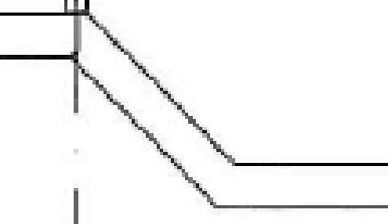
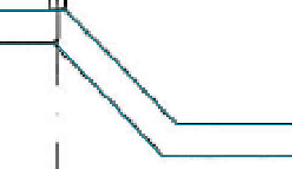
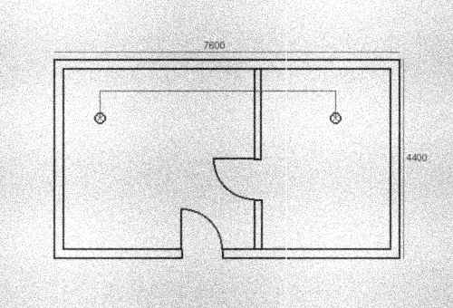
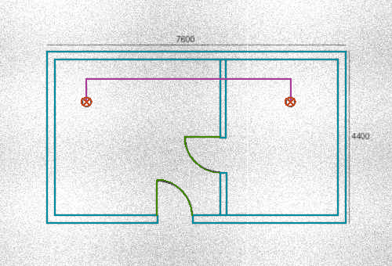

# Scan Plan Redraw

Скилл для Codex, который помогает перечертить плохой скан плана этажа в редактируемый AutoCAD DWG. Сначала агент восстанавливает стены, проёмы и двери по скану и читаемым размерам. Затем на эту основу можно нанести электрику или другую инженерную сеть. Разметка сохраняется отдельно, поэтому после замечания по одному узлу можно пересобрать чертёж и проверить примыкания.

### Как выглядит результат

| Фрагмент скана | Восстановленные грани поверх скана |
| --- | --- |
|  |  |

Реальный фрагмент содержит только поворот стены. В модели это две редактируемые полилинии. Масштаб перенесён с исходного листа. Подписанного размера внутри фрагмента нет. [Скачать DWG](wall-detail.dwg) · [Посмотреть разметку](wall-detail.json)

| Учебный скан с шумом и полосой | Архитектура и электрика поверх скана |
| --- | --- |
|  |  |

Вымышленный пример содержит 15 объектов в модели, включая две дверные дуги, два вхождения блока светильника и одну трассу. Геометрия задана в миллиметрах. Этот пример проверяет воспроизводимость сборки и служит образцом разметки. [Скачать DWG](demo.dwg) · [Посмотреть разметку](demo.json)

### Установка и запуск

Склонируйте репозиторий в каталог пользовательских скиллов и установите зависимости в своё окружение Python. Проверено на Windows с Python 3.12 и AutoCAD 2023. Для сборки DXF достаточно Python. Для записи и повторного открытия DWG нужен AutoCAD Core Console.

```powershell
git clone https://github.com/frieddum/scan-plan-redraw.git "$env:USERPROFILE/.agents/skills/scan-plan-redraw"
Set-Location "$env:USERPROFILE/.agents/skills/scan-plan-redraw"
python -m pip install -r requirements.txt
python scan_to_cad.py build demo.png demo.json check.dwg
```

Пример запроса в Codex: «Используй scan-plan-redraw. Перечерти второй лист в DWG. Сначала восстанови архитектуру и проверь её по размерным цепочкам. Затем нанеси освещение. Покажи наложение и укажи проёмы, которые нельзя уверенно прочитать».

Агент читает лист, сопоставляет размеры и задаёт разметку. Скрипт строит геометрию по этой разметке, проверяет контрольные размеры и сравнивает геометрию после записи DWG. Для каждой новой планировки требуется собственная интерпретация. [Инструкция скилла](SKILL.md) · [Формат разметки и команды](MODEL.md)

### Испытания

На двух рабочих сканах вручную размечены фрагменты наружных стен, перегородок и дверей. Через AutoCAD проверены соответственно 10 и 8 объектов. На контрольном горизонтальном пролёте 4200 мм получены 4179,9 и 4169,6 мм. Абсолютные расхождения составляют около одного пикселя на использованных обзорных изображениях. Точность в поперечном направлении и полнота восстановления этажей в этих испытаниях не оценивались.

### Смежные проекты

- Восстановление размерной геометрии по образцу и проверка результата. [AutoCAD Reference Rebuild](https://github.com/designrye846-ux/autocad-reference-rebuild)
- Рабочие приёмы для электротехнических чертежей. [CAD Electrical Drawing](https://github.com/fu1997rui-hash/cad-electrical-drawing)
- Нативные размеры AutoCAD и проверочный вывод. [AutoCAD Drawing Skill](https://github.com/XTL8866/autocad-drawing-skill)
- Размещение выносок и оформление листов. [CAD Callout Pair Layout](https://github.com/capskov/cad-callout-pair-layout) · [Luna CAD Sheet Layout](https://github.com/capskov/luna-cad-sheet-layout)
- Распознавание стен и проёмов как отдельное направление компьютерного зрения. [Floorplan to 3D](https://github.com/Yytsi/floorplan-to-3d)

